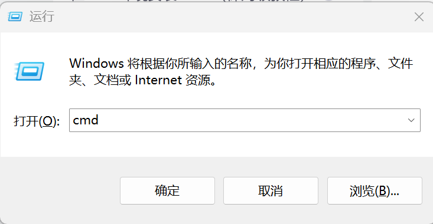
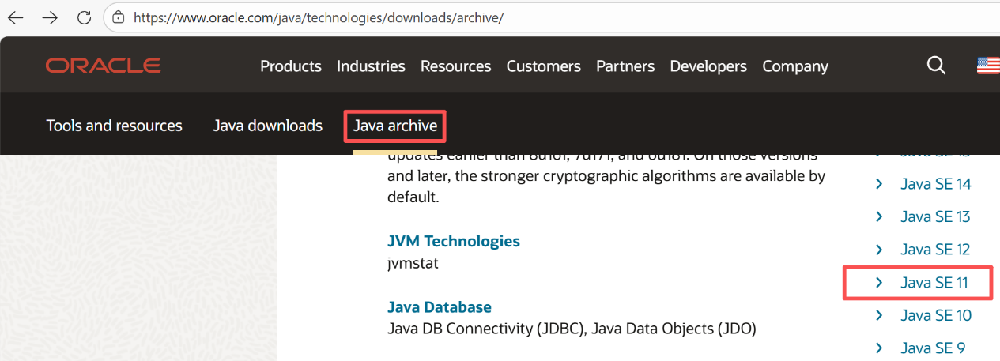
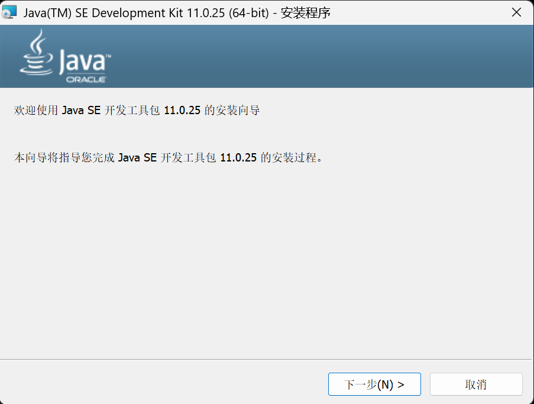
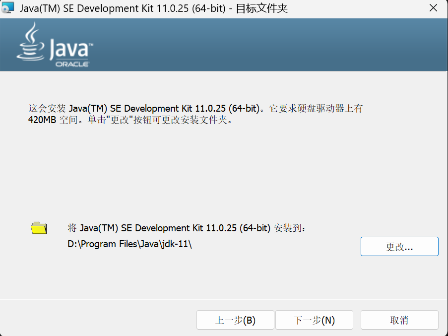
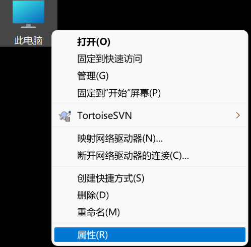
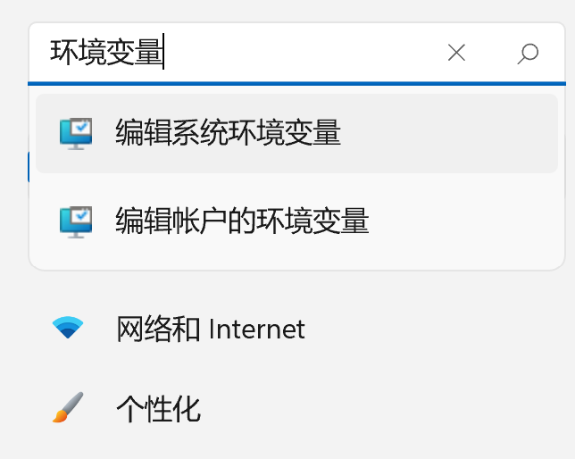
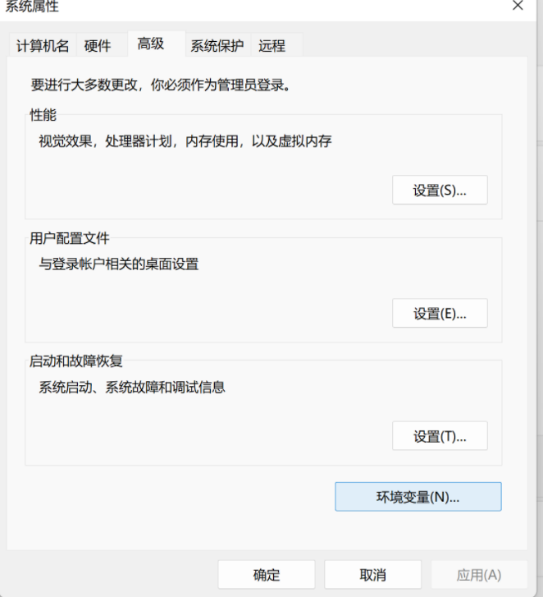
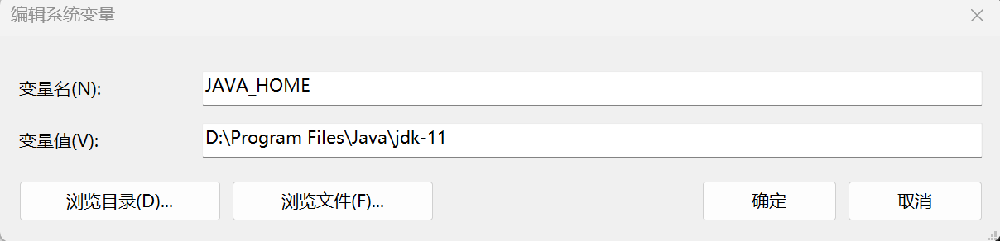
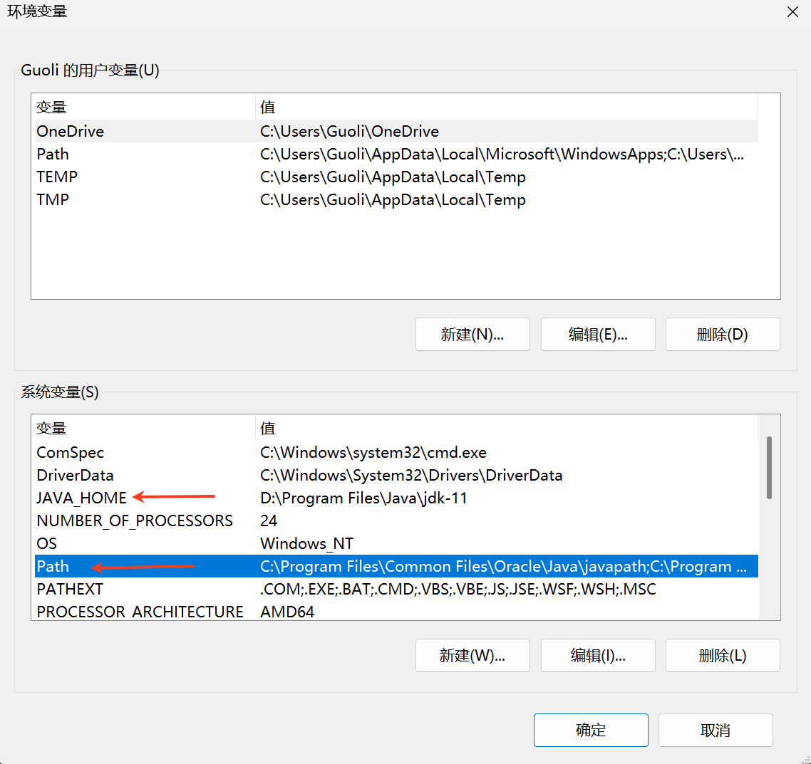
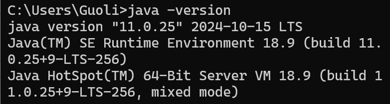

# 配置环境 {#sec-environment}

Yuan当前测试了Window操作系统的使用。Yuan使用了apache-maven-3.9.0和jdk-11，发布文件中内置了apache-maven-3.9.0。通过 @sec-check-install 节检验安装情况，运行Java时，通常，发布文件中没有提供内置的jdk-11，则需要用户自己安装，并配置环境变量，具体可参见 @sec-install-jdk 节。

## 检验是否安装 {#sec-check-install}

Win + R 键输入cmd，如 @fig-218410705 所示。进入到Windows控制台，然后输入 `java -version`，出现 `'java' 不是内部或外部命令，也不是可运行的程序或批处理文件`，说明未安装。

{#fig-218410705 width="3.83in"}

如果出现了类似 @fig-218410927 的提示信息，说明安装成功，可以跳过 @sec-install-jdk 节，直接使用Yuan。

## 安装jdk-11 {#sec-install-jdk}

本节基于jdk-11，演示下载安装和配置过程。如果已经安装可以跳过本节。

### 下载 {#sec-download}

官网地址 <https://www.oracle.com/java/technologies/downloads/>，借鉴 @fig-218411699 寻找jdk-11 的版本，并下载安装。需要自己注册一个Oracle账号，下载的时候需要登录。本文选择的版本是jdk-11.0.25_windows-x64_bin.exe。jdk-11.0.2版本在编译Yuan时出现了英文代码注释乱码问题，建议使用jdk-11.0.25。

{#fig-218411699 width="5.75in"}

### 安装 {#sec-install}

双击打开下载好的文件，出现 @fig-218412540 ，点击下一步。

{#fig-218412540 width="4.43in"}

在 @fig-218412595 中，选择合适的安装目录。

{#fig-218412595 width="4.19in"}

### 配置环境变量 {#sec-env-vars}

本文以Win11为例演示添加jdk环境变量。不同系统的环境变量设置方式，可通过网络查询具体方法。

{#fig-218418013 width="2.25in"}

右击“此电脑”选择属性，如 @fig-218418013 所示，在弹出的如 @fig-218418029 设置窗口中搜索“环境变量”，选择“编辑系统环境变量”。

{#fig-218418029 width="2.26in"}

在弹出的 @fig-218418049 的“系统属性”中，点击环境变量按钮。

{#fig-218418049 width="2.47in"}

#### 添加JAVA_HOME {#sec-add-java-home}

在系统变量中点击新建，设置变量名为 JAVA_HOME，变量值填入刚刚安装的 JDK 的路径， @fig-218413125 中的“变量值”用自己电脑jdk的实际路径替代。

{#fig-218413125 width="5.11in"}

#### 配置Path {#sec-config-path}

Path变量中包含了系统可以执行的文件路径。当你在命令行中输入 java 或 javac 命令时，操作系统会根据 Path环境变量的配置查找可执行文件。

{#fig-218433298 width="4.13in"}

在 @fig-218433298“环境变量”对话框中，找到并选中“系统变量”区域中的 Path 变量，然后点击“编辑”， 添加 `%JAVA_HOME%\bin` 到 Path 中。

{#fig-218410927 width="4.89in"}

按照 @sec-check-install 节检验安装，如果出现了类似 @fig-218410927 的提示信息，说明安装成功，可以跳过 @sec-install-jdk 节，直接使用Yuan。
