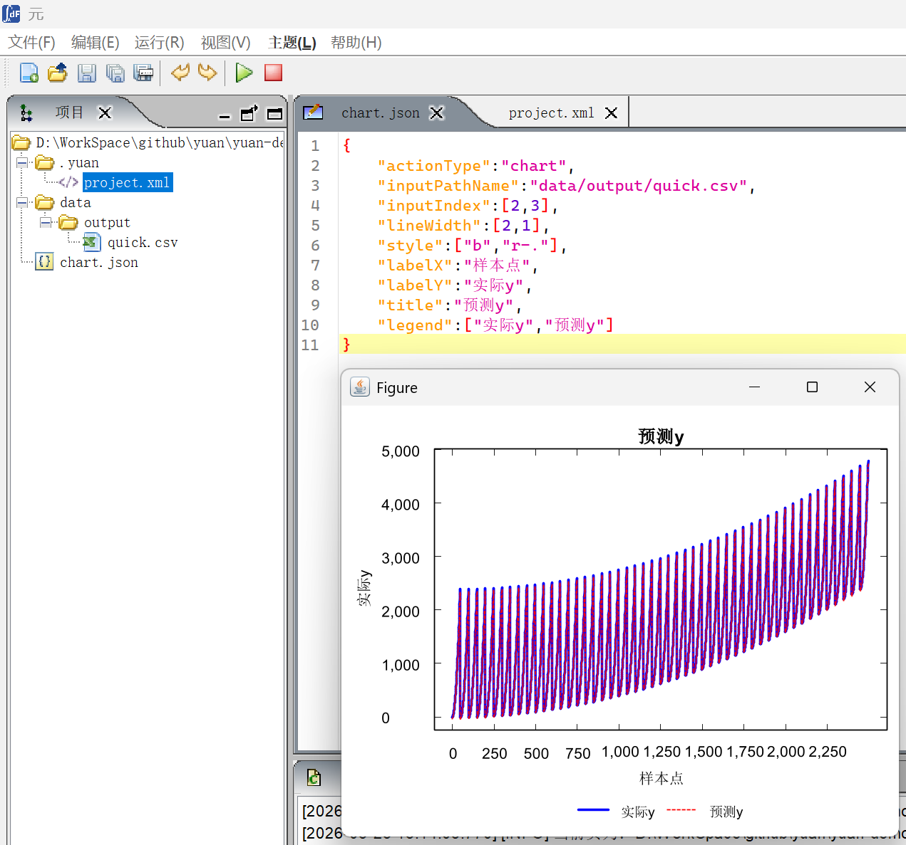
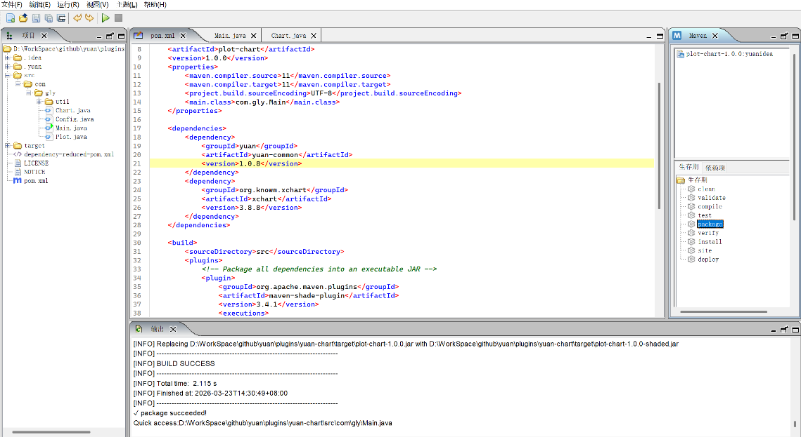

# 添加插件

在添加插件前，首先，参考[第2章](02-environment.qmd#配置环境)配置平台运行时必要的环境。然后，参考[第3章](03-quickstart.qmd#快速入门)的[3.1.1](03-quickstart.qmd#安装yuan-common) 节安装插件依赖的yuan-common。

## 快速使用插件

Yuan平台中已经自带了一个绘图插件可以直接使用，其存放目录为 `D:\WorkSpace\github\yuan\yuan-platform\target\artifacts\yuan\plugins\`。平台启动时，在"输出"面板中如果出现了"✅ Plugin loaded successfully:com.gly.Chart"，则说明插件可以直接使用。

Yuan平台中也提供了一个默认的yuan-chart插件测试项目。使用元智能平台打开\\yuan\\yuan-demo\\quick项目，打开"chart.json"文件。点击工具栏中的三角形的运行按钮，运行效果如[图 4-1](#_Ref225164289)所示。

{#_Ref225164289 width="3.77in"}

在yuan\\yuan-demo\\quick\\.yuan\\project.xml目录下配置文件内容为[配置 4-1](#_Ref225164699)，如果没有此配置文件，工具栏的"运行"按钮无法使用。

[]{#_Ref225164699}

```{.xml filename="配置 4-1 project.xml"}
<project>
<type>model</type>
</project>
```

## 创建插件

以plot-chart插件为例，yuan平台的插件的pom.xml中只显示了必须包含yuan-common依赖，实现yuan平台规定的插件接口。[配置 4-2](#_Ref225175111)中，plot-chart依赖的yuan-common版本是1.0.8。

[]{#_Ref225175111}

```{.xml filename="配置 4-2 pom.xml"}
<dependency>
<groupId>yuan</groupId>
<artifactId>yuan-common</artifactId>
<version>1.0.8</version>
</dependency>
```

插件的源文件需要放在src/com/gly目录下，例如plot-char的入口类Chart.java的包名为"package com.gly"。

插件的入口类必须实现yuan-common中定义的ExecutableUnit接口。例如，plot-chart插件的入口类Chart.java继承了yuan-common中的抽象类BaseExecutable，而BaseExecutable实现了ExecutableUnit接口。

此外，自定义的入口类中，如果使用json配置文件，可以自行封装解析逻辑。实现完成后，就可以通过[4.2](#创建插件) 节介绍的方法添加自己实现的插件了。

## 编译和发布插件

使用Yuan打开yuan\\plugins\\yuan-chart项目，选择Maven面板中的Package命令，如[图 4-2](#_Ref225169142)所示，运行成功后在yuan\\plugins\\yuan-chart\\target目录下就会生成一个plot-chart-1.0.0.jar文件。

{#_Ref225169142 width="5.17in"}

yuan\\yuan-platform\\target\\artifacts\\yuan\\plugins\\plot-chart\\lib将生成的plot-chart-1.0.0.jar拷贝到yuan\\yuan-platform\\target\\artifacts\\yuan\\plugins\\plot-chart\\lib目录后，重新启动Yuan平台，插件就添加完成。如果想将插件去掉，只需要将plot-char文件夹整体删除就可以了。
