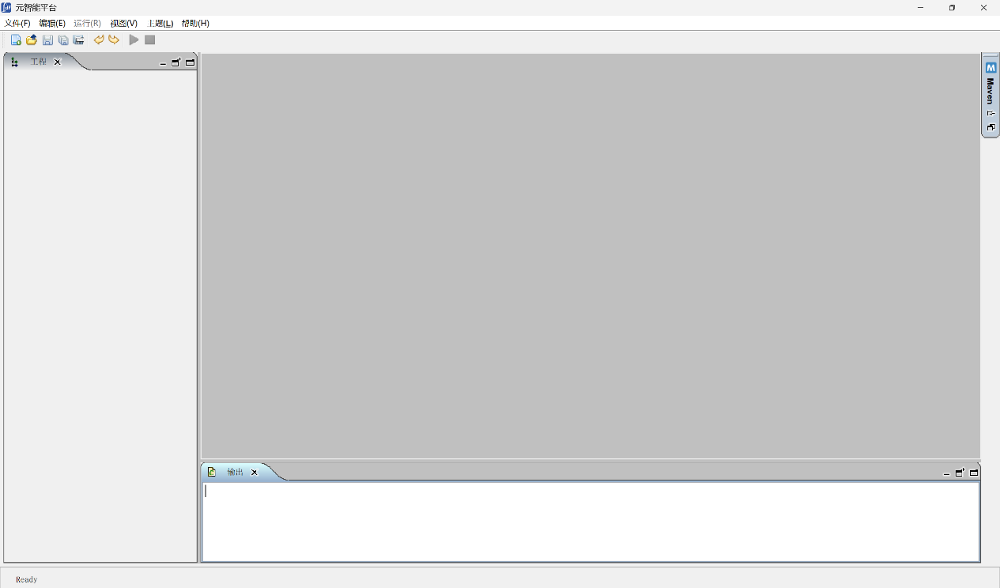
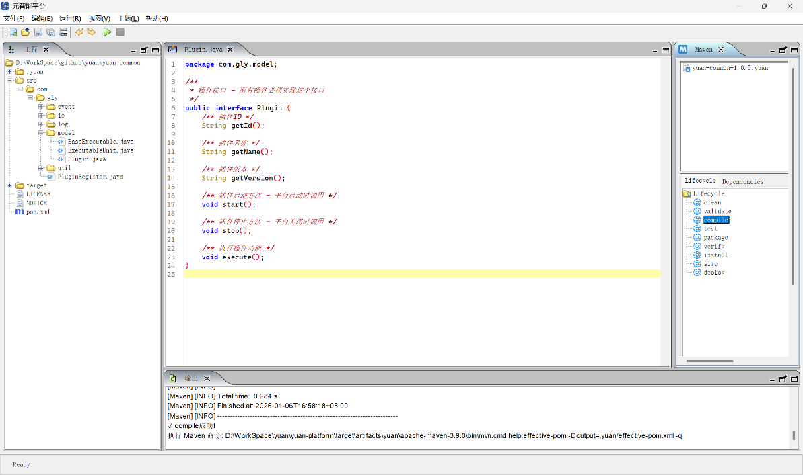
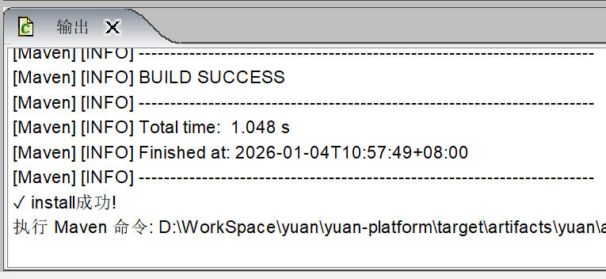
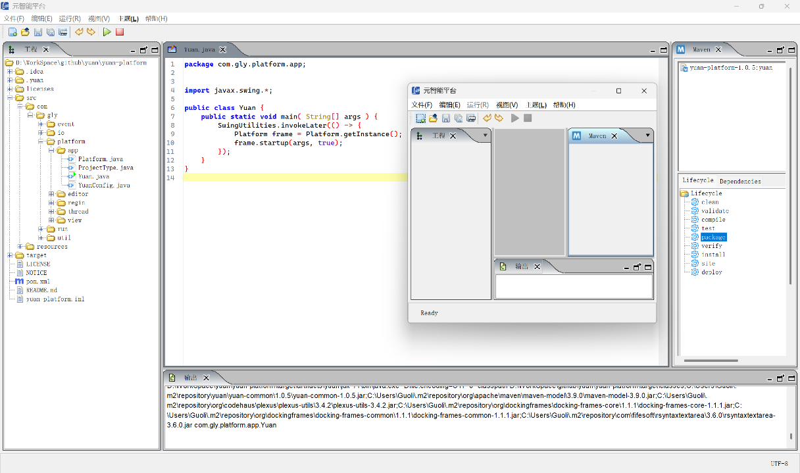
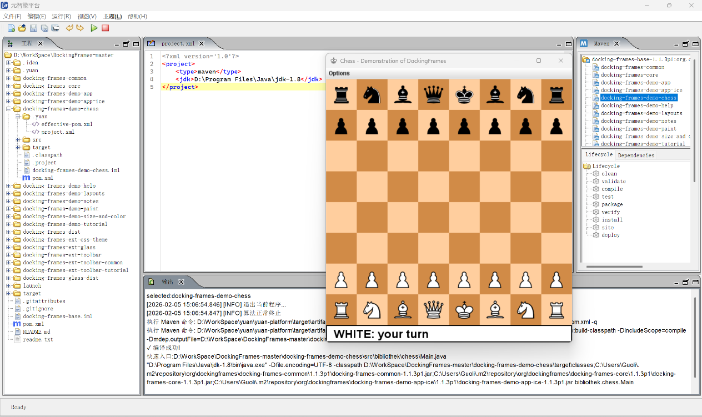
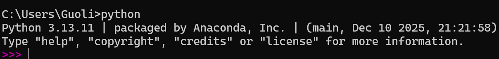
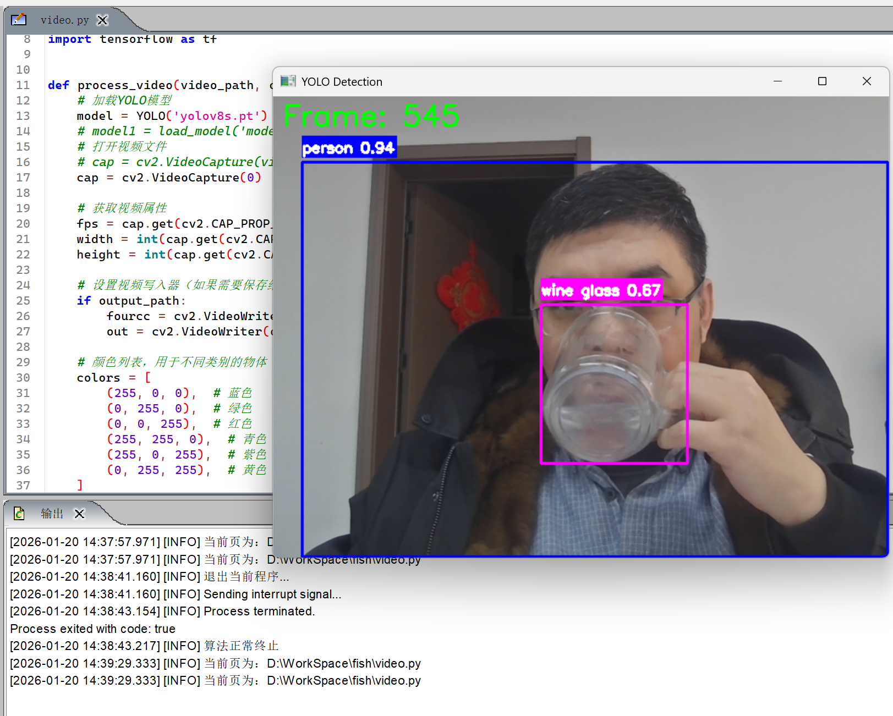
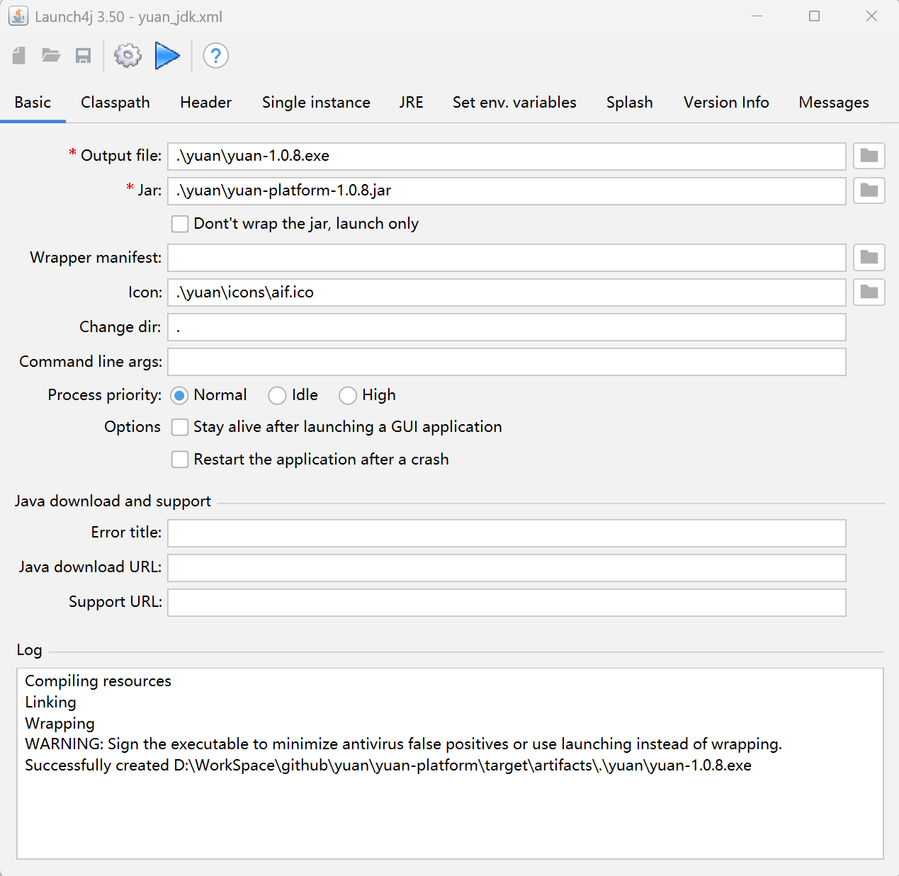
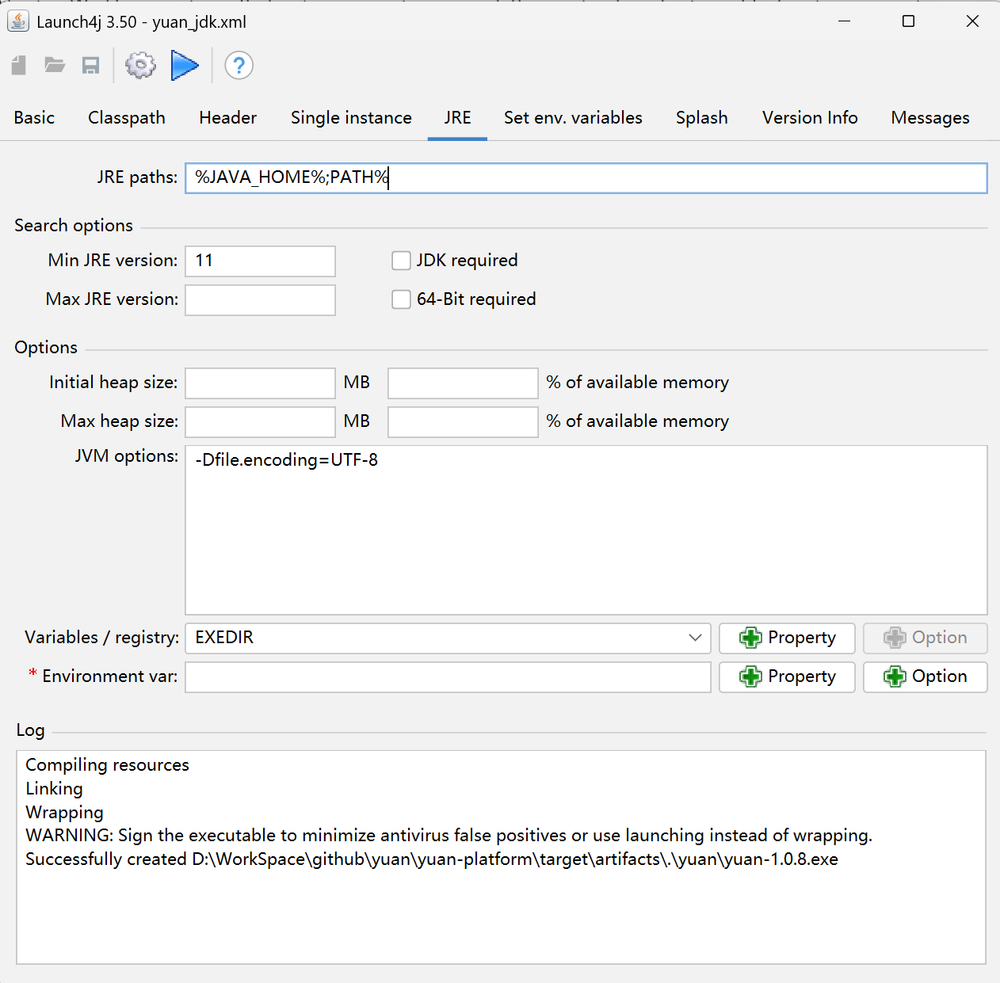

# 快速入门

按[第2章](environment.qmd#配置环境)配置了平台运行环境后，在 <https://github.com/YuanIdea/yuan> 下载Yuan源码，双击后出现 @fig-218415989 平台界面，不同的版本会略有差异。注意，不要直接使用 `yuan\yuan-platform\target\artifacts\yuan\yuan.exe`，因为使用这个目录下的可执行文件时，打包yuan-platform会因 `yuan-platform.jar` 正被 `yuan.exe` 占用而出错，需要先把 `yuan\yuan-platform\target\artifacts\yuan` 拷贝到其它目录后再打开。

{#fig-218415989 width="5.75in"}

## 运行平台

本节介绍在Yuan平台内编译，安装依赖和打包Yuan平台。

### 安装yuan-common

选择平台中的“文件”→“打开目录”菜单栏。选择yuan-common的根目录。在右边的maven停靠窗口的“生存期”中，双击“compile”命令，运行效果如 @fig-218416554 所示。在底部的输出停靠窗口中，会出现“✓ compile succeeded!”等编译信息。

{#fig-218416554 width="5.42in"}

点击“install”命令，将yuan-common安装到仓库，成功后输出面板如 @fig-218416817 所示。

{#fig-218416817 width="4.25in"}

### 运行yuan-platform

安装完yuan-platform后，就可以运行yuan-platform了。同样，可以使用工具栏的“打开目录”按钮，打开yuan-platform的根目录。点击工具栏的绿色三角“运行”按钮，可以看到编译和运行yuan-platform源码后的效果为 @fig-218417268 。

{#fig-218417268 width="5.52in"}

### 打包yuan-platform

右边的maven停靠窗口的Lifecycle中，双击“package”命令后，将yuan-platform打包到了yuan-platform/target/artifacts/yuan/yuan-platform-1.0.8.jar中，在命令行中切换到yuan-platform/target/artifacts/yuan目录后使用java -jar yuan-platform-1.0.8.jar命令，同样可以打开 @fig-218415989 所示界面。

## 运行Maven项目

Yuan平台支持对标准类型Maven项目，以yuan平台使用的第３方docking-frames为例，在当前要运行的“工程”资源管理中添加配置文件.yuan/project.xml，见 @lst-208924315 。


```{.xml #lst-208924315 lst-cap="project.xml"}
<?xml version='1.0'?>
<project>
<type>maven</type>
<jdk>D:\Program Files\Java\jdk-1.8</jdk>
</project>
```

其中，type指定了是maven类型的项目，jdk指定了当前工程中使用的jdk存储路径，docking-frames选择jdk-1.8版本进行编译，如果没有设置jdk标签，默认使用的是JAVA_HOME中指定的JDK，见[2.2.3.1](environment.qmd#添加java_home) 节。

在右边的Maven停靠面板中选择docking-frames-demo-chess，将需要的依赖添加到仓库后，点击运行按钮出现 @fig-221197588 。

{#fig-221197588 width="5.75in"}

注意，在运行工程前，需要将所有的本地依赖，使用Maven中的install暗装到仓库。通常，在使用yuan平台打开包含pom.xml的根目录时，平台会默认创建一个.yuan/project.xml的配置文件，用户可以根据需要修改配置内容。

## 运行Python

使用Yuan平台运行Python代码前，需要自行安装python环境，Yuan只提供了编辑和运行Python的功能。安装Python成功后，在命令行中输入python命令，如果类似现出 @fig-221202022 所示Python版本信息，则安装成功。

{#fig-221202022 width="5.75in"}

在yuan平台打开项目后，添加配置文件.yuan/project.xml，见 @lst-221202525 。


```{.xml #lst-221202525 lst-cap="project.xml"}
<?xml version='1.0'?>
<project>
<type>python</type>
<pythonHome>D:/ProgramData/anaconda3/envs/python310</pythonHome>
</project>
```

其中，type指定了是Python类型的项目，pythonHome指定了当前工程中使用的python.exe存储路径。

{#fig-221202964 width="3.77in"}

@fig-221202964 演示了就是Yuan平台中，通过Python调用yolov模型，进行图像识别的过程。

## Launch4生成EXE

本文使用了一款Launch4j工具将Yun 的JAR包封装为Windows原生可执行文件.exe。如果不需要生成.exe，可以跳过本节。

### Launch4j简介

Launch4j是一款开源工具，可将Java应用程序的JAR包封装为Windows原生可执行文件(exe)，解决用户端无JRE环境时的运行问题。其优势在于支持自定义图标、JRE版本绑定、启动参数配置等，且生成的EXE文件兼容性强。

下载路径为\[https://sourceforge.net/projects/launch4j/files/launch4j-3/3.50/\]，选择launch4j-3.50-win32.exe进行下载。双击下载的 launch4j-3.50-win32.exe自行安装。

### 环境准备

Java环境：确保本地已安装JDK/JRE，并配置好环境变量，见[2.2](environment.qmd#安装jdk-11) 节。

JAR文件：需打包的Java程序需已编译为可执行JAR，见[3.1.3](#打包yuan-platform) 节。

### 详细打包步骤

启动安装好的 Launch4j，打开配置文件yuan\\yuan-platform\\target\\artifacts\\ yuan_jdk.xml，其中Basic选项卡如 @fig-225091624 所示。

{#fig-225091624 width="4.49in"}

其中，Output file：设置生成的 EXE 路径；Jar：选择待打包的 JAR 文件路径；Icon（可选）：添加 EXE 图标（需 .ico 格式）。

进入JRE选项卡，根据设置JRE的路径，如 @fig-225092893 所示。

{#fig-225092893 width="4.91in"}

Min JRE version：填写最低兼容的JRE版本。Bundled JRE path：指定相对路径。JVM Options：可以添加需要的参数，譬如-Dfile.encoding=UTF-8。

其它参数根据需要自行调整，配置完成后，点击Build wrapper按钮后，yuan\\yuan-platform\\target\\artifacts\\yuan路径下可以看到生成的yuan-1.0.8.exe。

## 小结

本节介绍了Yuan的使用，并在Yuan内编译安装了yuan-common到仓库。并在Yuan中编译运行了yuan-platform，以及生成yuan.exe可执行文件。演示了Yuan的具体使用。当前Yuan只支持标准的Maven项目和简单的Python运行。
