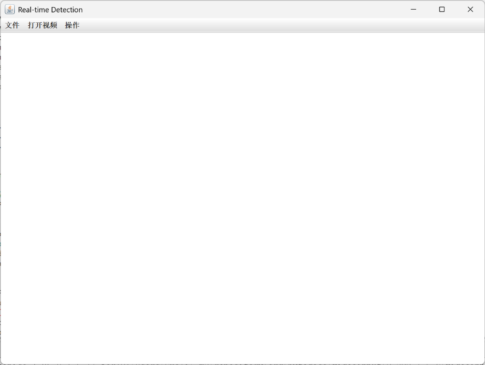
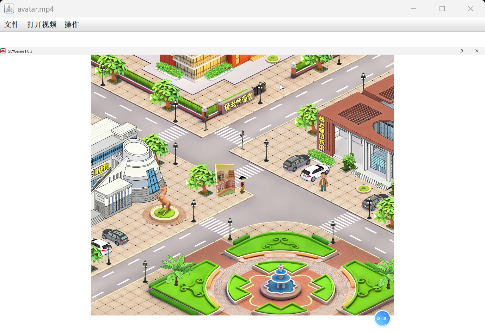
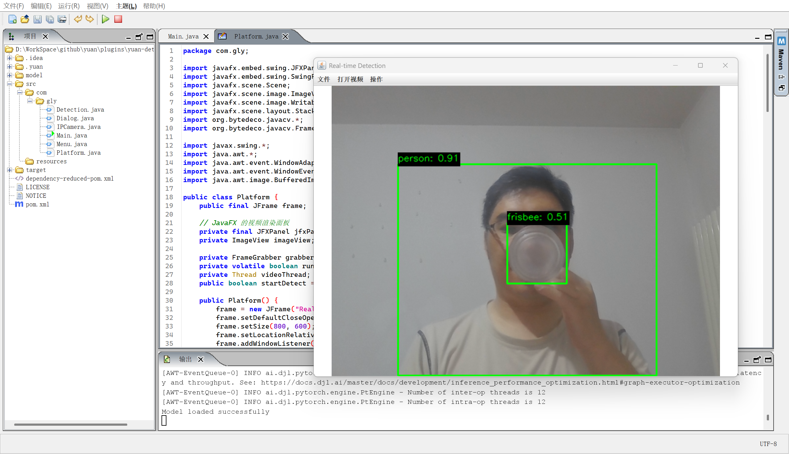
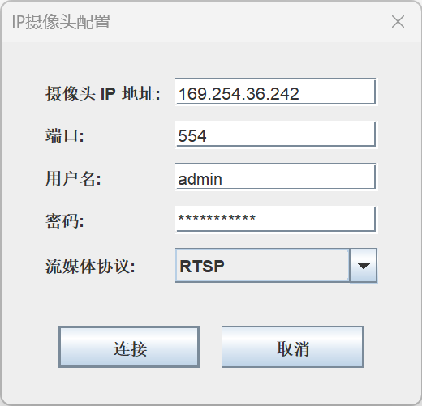
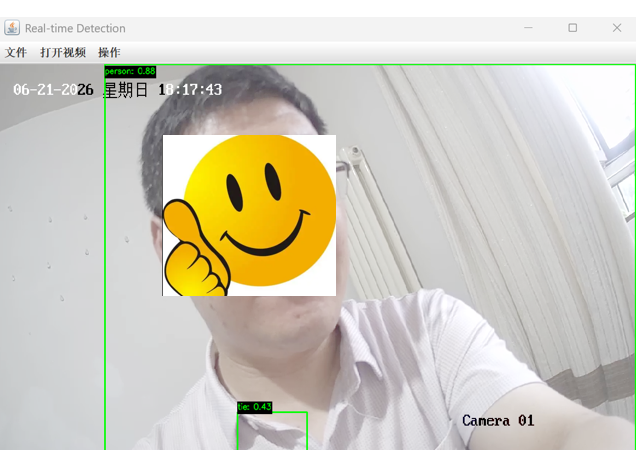
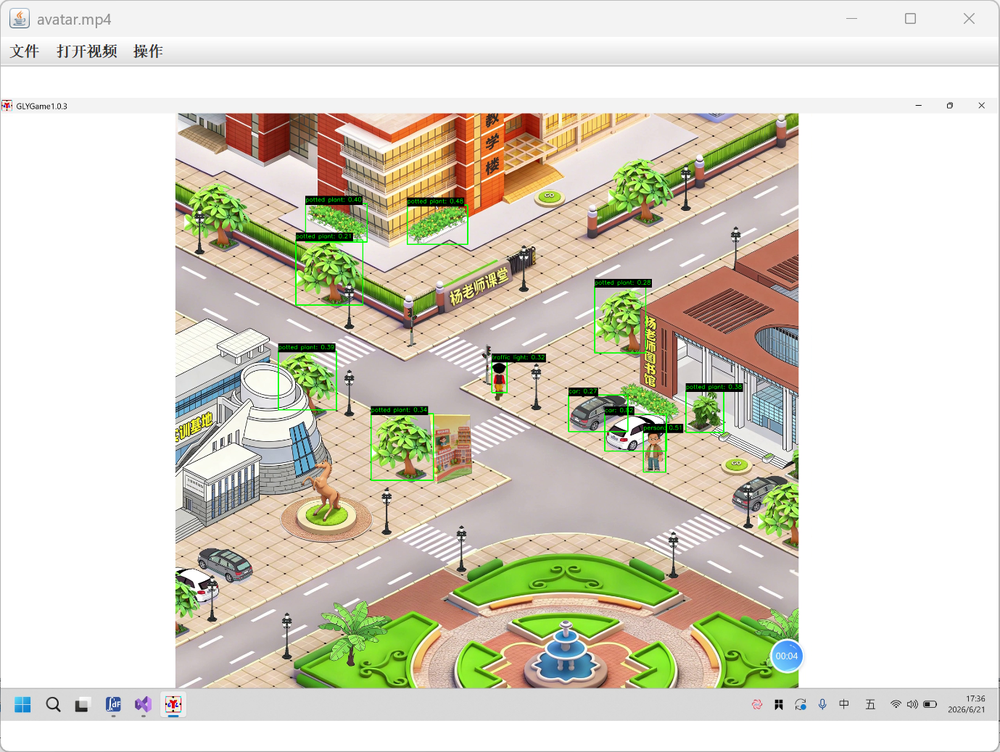
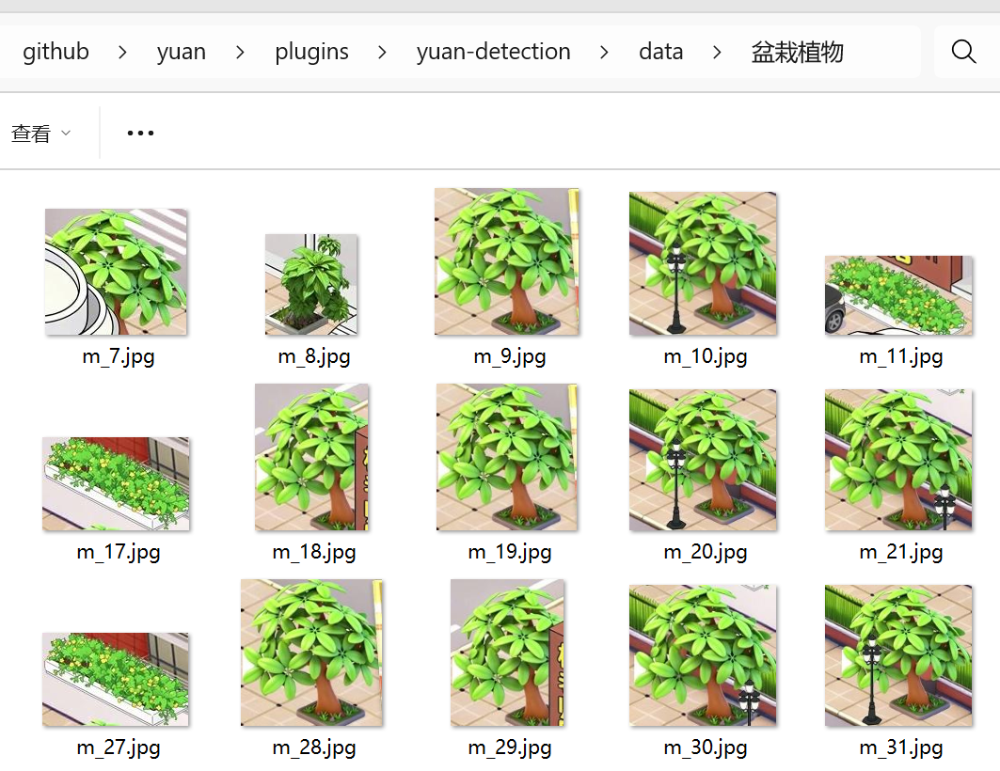

# 视频检测

本项目当前支持对MP4视频，笔记本自带摄像头，网络摄像头的目标追踪，以中文和英文方式显示标签。支持对视频中的目标图像，自动分类抠图。

在使用视频检测前，到 <https://github.com/YuanIdea/yuan> 下载源码，其中，`yuan\plugins\yuan-detection` 目录下为Java版的视频检测项目。

## 环境配置

本章介绍如何通过DJL在java中调用yolov8进行推理。Deep Java Library是由亚马逊（Amazon）提供的一个深度学习工具包，能够让java开发者在java上调用目前主流的深度学习框架，像pytorch、tensorflow、mxnet、paddlepaddle,也包括onnx格式的模型。

### 环境

YuanIdea1.8 or Idea、pytorch-native-cpu-2.7.1、java11、Deep Java Library0.36.0、yolov8s、javacv1.5.11

### 导出yolov8s模型

本章节直接使用yolov8s的预训练模型，导出模型前，用户需要自行下载yolov8s.pt文件放在与导出[代码 5-1](#_Ref232760312)同目录下，模型导出脚本是[代码 5-1](#_Ref232760312)。

[]{#_Ref232760312}

```{.python filename="代码 5-1 export.py"}
from ultralytics import YOLO


def export_torchscript_model():
    model_path = "yolov8s.pt"
    input_size = 640

    model = YOLO(model_path)
    model.export(
        format="torchscript",
        imgsz=input_size,
        device="cpu",
        half=False,
        dynamic=False,
        simplify=True
    )


export_torchscript_model()
```

导出成功后显示信息为下面所示，注意，本文版本python3.13，torch-2.9.1。

```text
Ultralytics 8.3.250 Python-3.13.11 torch-2.9.1+cu128 CPU (AMD Ryzen AI 9 HX 370 w/ Radeon 890M)
YOLOv8s summary (fused): 72 layers, 11,156,544 parameters, 0 gradients, 28.6 GFLOPs
PyTorch: starting from 'yolov8s.pt' with input shape (1, 3, 640, 640) BCHW and output shape(s) (1, 84, 8400) (21.5 MB)
TorchScript: starting export with torch 2.9.1+cu128...
TorchScript: export success 2.1s, saved as 'yolov8s.torchscript' (43.0 MB)
Export complete (2.8s)
Results saved to D:\WorkSpace\fish
Predict: yolo predict task=detect model=yolov8s.torchscript imgsz=640
Validate: yolo val task=detect model=yolov8s.torchscript imgsz=640 data=coco.yaml
Visualize: https://netron.app
Process finished with exit code 0
```

将自己导出的或者是上面网址中下载的yolov8s.torchscript文件，放在yuan-detection/model/目录下。

## 启动程序

可以使用YuanIdea或者IntelliJ IDEA运行yuan-detection，运行效果如[图 5-1](#_Ref232787387)所示。

{#_Ref232787387 width="4.61in"}

### 打视频源

当前支持三种视频源，本地的MP4，笔记本自带的摄像头，网络摄像头。

#### 视频

选择“打开视频”菜单下的“本地视频”，选择一个提前录制好的mp4视频，效果如[图 5-2](#_Ref232956430)。

{#_Ref232956430 width="5.75in"}

#### 本地摄像头

选择“打开视频”菜单下的“本摄像头”。选择“操作”菜单下的“目标追踪”，如[图 5-3](#_Ref232957462)为笔记本摄像头的目标追踪。

{#_Ref232957462 width="5.75in"}

#### 网络摄像头

选择“打开视频”菜单下的“网络摄像头”。在[图 5-4](#_Ref232959808)中先择“RTSP”协议，配置网络摄像头的连接信息。

{#_Ref232959808 width="3.66in"}

选择“操作”菜单下的“目标追踪”，[图 5-5](#_Ref232958597)为海康网络摄像头的的目标追踪。

{#_Ref232958597 width="3.81in"}

### 目标追踪

打开任意一种视频源，例如[图 5-2](#_Ref232956430)，选择“操作”菜单下的“目标追踪”，为效果[图 5-6](#_Ref232956809)。

{#_Ref232956809 width="5.75in"}

再次点击“目标追踪”菜单，可以取消目标追踪功能，回到普通视频状态，如[图 5-2](#_Ref232956430)所示。

### 切换中英文标签

点击“文件”下的“中文标签”菜单，实现中英文标签的实时切换，在显示目标追踪标签时，可以看到中英文标签效果。

### 分类截图

点击“操作”下的“保存分类截图”菜单，可以启动将追踪的分类保存到磁盘功能，保存为当前项目的data文件夹下。例如，将[图 5-6](#_Ref232956809)中的内容分类保存效果为[图 5-7](#_Ref233318331)。

{#_Ref233318331 width="5.75in"}
